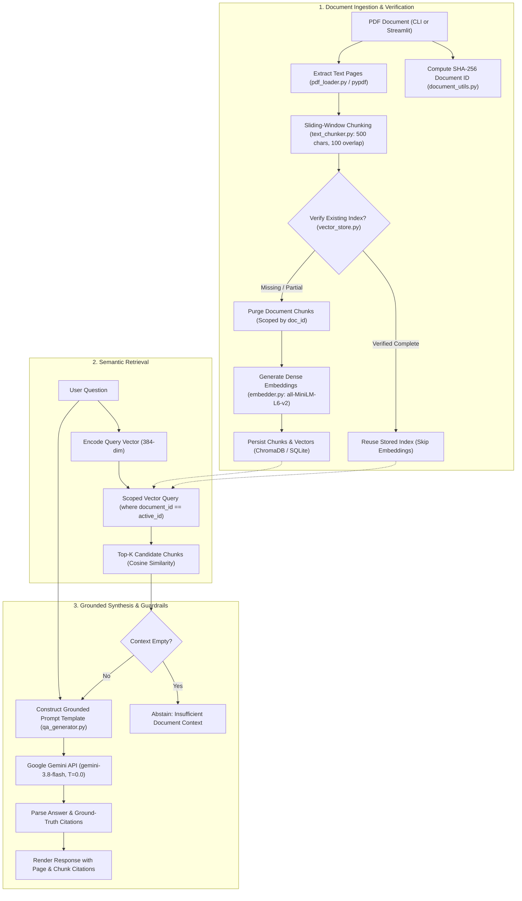

# DocuMind — AI-Powered PDF Study Assistant & Grounded RAG System

[](https://www.python.org/)
[](https://streamlit.io/)
[](https://www.trychroma.com/)
[](https://ai.google.dev/)
[](https://huggingface.co/sentence-transformers/all-MiniLM-L6-v2)
[](LICENSE)

DocuMind is an open-source, local-first Retrieval-Augmented Generation (RAG) study assistant. It transforms complex academic and technical PDF documents into an interactive question-answering system. By coupling local semantic search (`SentenceTransformers` and persistent `ChromaDB`) with Google's `Gemini 3.8 Flash` large language model, DocuMind produces grounded, fact-checked responses accompanied by page- and chunk-level citations.

---

## Live Demo & Screenshots

> [!NOTE]
> **Deployment Notice:** DocuMind is currently in local development and testing. A hosted live demonstration link on Streamlit Community Cloud will be published here upon completion of the deployment milestone.

### Application Preview
```
+-------------------------------------------------------------------------------+
|  DocuMind — AI PDF Study Assistant                                            |
|  [ Sidebar ]                      [ Main Interactive Q&A Area ]               |
|  - Upload PDF (drag & drop)       - Grounded Gemini Answer Box                |
|  - Ingestion Status & Metrics     - Strict Page & Chunk Attribution Badges    |
|  - Document ID (SHA-256)          - Retrieved Context Expander (Top-K Chunks) |
|  - Index Verification Status      - Raw Similarity & Cosine Distance Scores   |
+-------------------------------------------------------------------------------+
```
*(Visual screenshot artifacts will be added in an upcoming UI release step.)*

---

## Problem Statement & Project Goals

Large Language Models (LLMs) often suffer from two notable shortcomings when applied to specialized documents:
1. **Hallucinations & Ungrounded Generalizations:** Models generate plausible-sounding facts not present in the reference document.
2. **Context Window Inefficiencies & Cost:** Feeding an entire 50-page textbook or technical manual into every prompt is computationally wasteful and economically impractical.

### Project Goals
- **Strict Grounding:** Restrict the LLM's synthesis strictly to context retrieved from the source document. If the document does not contain the answer, the model must explicitly abstain.
- **Traceable Attribution:** Every response provides exact source citations (page number and chunk sequence) so users can immediately verify claims against the original document.
- **Local-First Privacy & Efficiency:** Document parsing, text chunking, embedding generation, and vector indexing run entirely on your local machine. Only the top-k retrieved text passages for a specific query are transmitted over TLS to the Gemini API.
- **Dual-Interface Flexibility:** Provide both a responsive **Streamlit Web UI** for everyday users and a headless **CLI Pipeline** for scripting, bulk processing, and automated verification.

---

## Key Features

- **Content-Addressable Document Hashing:** Uses full 64-character SHA-256 cryptographic hashing (`doc_<sha256>`) of raw PDF bytes. Documents are identified deterministically regardless of filename changes.
- **Defensive Two-Phase Ingestion & Index Verification:** Inspects existing vector records before embedding. If a complete, sequential index exists, DocuMind reuses it instantly, eliminating redundant computation.
- **Document-Scoped Deletion Recovery:** If an ingestion run is interrupted, DocuMind safely isolates and purges only orphaned records matching that specific document ID before re-indexing, preventing cross-document data corruption.
- **Sliding-Window Text Chunking:** Configurable character-level sliding window (default: 500 characters, 100 character overlap) preserving cross-boundary semantic context.
- **Local Dense Embeddings:** Encodes text using the lightweight `all-MiniLM-L6-v2` SentenceTransformer model (384-dimensional dense vectors).
- **Persistent Vector Storage:** Stores embeddings and metadata locally in ChromaDB backed by SQLite and HNSW indexing with cosine distance scoring.
- **Document-Scoped Semantic Retrieval:** Restricts nearest-neighbor vector queries strictly to the active document ID (`where={"document_id": doc_id}`), preventing cross-document information leaks.
- **Grounded Gemini Synthesis:** Employs greedy argmax decoding ($T=0.0$) via `google-genai` SDK on `gemini-3.8-flash` to minimize sampling variance and prevent speculation.
- **Defensive Error Sanitization:** Multi-layered regex redaction strips active API keys, `AIza...` tokens, query parameters (`?key=...`), and `Bearer` tokens from all UI alerts and terminal logs.

---

## System Architecture



---

## RAG Workflow Deep-Dive

1. **PDF Text Extraction:** Reads the input document using `pypdf`, tracking page numbers and validating content. Handles password-protected read-only files and guarantees open file-descriptor cleanup in a `finally` block.
2. **Text Chunking:** Splits extracted page texts into overlapping segments (default: 500 characters with 100 character overlap). Each chunk retains its 1-indexed `chunk_id` and originating `page_number`.
3. **Index Verification:** Queries ChromaDB for `where={"document_id": doc_id}`. Verifies that the record count matches expected chunks, IDs form an unbroken sequence (`doc_..._chunk_1` to `N`), and text bodies are non-empty.
4. **Vector Embedding:** Encodes new chunks into 384-dimensional dense vectors using Hugging Face's `sentence-transformers/all-MiniLM-L6-v2`.
5. **ChromaDB Storage:** Persists embeddings, text chunks, and metadata records into a local `./chroma_db` directory configured with cosine similarity metric (`hnsw:space: cosine`).
6. **Scoped Semantic Search:** When a user poses a question, DocuMind embeds the query and retrieves the top-3 nearest neighbor chunks belonging strictly to the active document.
7. **Grounded Answer Synthesis:** Formats retrieved text chunks into a constrained system prompt sent to `gemini-3.8-flash`. With sampling temperature locked to `0.0`, the model synthesizes an answer referencing only provided excerpts and cites page numbers.

---

## Tech Stack & Core Libraries

| Technology / Library | Version | Purpose in DocuMind |
| :--- | :---: | :--- |
| **Python** | `>= 3.10` | Core programming language for the application and test suites. |
| **Streamlit** | `>= 1.35.0` | Reactive web interface for document uploads, interactive queries, and citation inspection. |
| **pypdf** | `>= 5.0.0` | Fast, dependency-free PDF parsing, page extraction, and defensive error classification. |
| **sentence-transformers** | `>= 3.0.0` | Local embedding model (`all-MiniLM-L6-v2`) generating 384-dimensional dense vectors. |
| **chromadb** | `>= 0.5.0` | Embedded vector database with SQLite storage and persistent HNSW nearest-neighbor indexes. |
| **google-genai** | `>= 0.1.0` | Official Google GenAI SDK for low-latency synthesis with `gemini-3.8-flash`. |
| **python-dotenv** | `>= 1.0.0` | Secure environment configuration from local `.env` files. |
| **unittest** | Standard Lib | Full regression testing with zero third-party test framework dependencies. |

---

## Repository Structure

```
DocuMind-RAG/
├── .env.example              # Public template with placeholder environment variables
├── .gitignore                # Rules ignoring .env, .venv, chroma_db, caches, and logs
├── README.md                 # Complete system documentation and onboarding guide
├── requirements.txt          # Pinned runtime Python dependencies
├── app.py                    # CLI application entry point (ingest, verify, search, Q&A)
├── streamlit_app.py          # Streamlit web UI application entry point
│
├── data/                     # Offline test assets
│   ├── blank.pdf             # Minimal valid PDF with 0 extractable text characters
│   └── sample.pdf            # Sample test PDF for offline ingestion tests
│
├── src/                      # Core modular architecture
│   ├── document_utils.py     # Cryptographic SHA-256 document hashing helpers
│   ├── embedder.py           # SentenceTransformer model wrapper and vector generator
│   ├── pdf_loader.py         # PDF text extractor with clean resource management
│   ├── qa_generator.py       # Grounded Gemini synthesis, prompt templates, error sanitization
│   ├── semantic_search.py    # NumPy cosine similarity search utilities
│   ├── text_chunker.py       # Sliding-window character chunking logic
│   └── vector_store.py       # ChromaDB client, indexing, query, and scoped deletion
│
└── test_*.py (10 files)      # Comprehensive unit and integration test suite
    ├── test_chunker.py            # Tests for text chunking boundaries and overlaps
    ├── test_cli_ingestion.py      # Tests for CLI index verification and failure recovery
    ├── test_document_utils.py     # Tests for SHA-256 document ID derivation
    ├── test_embedder.py           # Tests for embedding generation and caching
    ├── test_pdf_loader.py         # Tests for PDF extraction, error classes, and bad files
    ├── test_qa_generator.py       # Tests for Gemini prompt builder and error sanitization
    ├── test_semantic_search.py    # Tests for in-memory cosine ranking
    ├── test_streamlit_ingestion.py# Tests for Streamlit file processing and state guards
    ├── test_streamlit_qa.py       # Tests for Streamlit Q&A execution and session state
    └── test_vector_store.py       # Tests for ChromaDB upsert, query, and index verification
```

---

## Prerequisites

- **Operating System:** Windows 10/11, macOS, or Linux.
- **Python:** Version `3.10`, `3.11`, or `3.12` installed and added to system `PATH`.
- **Google Gemini API Key:** A free API key obtained from [Google AI Studio](https://aistudio.google.com/app/apikey).
- **Git:** Git CLI for repository cloning.

---

## Local Installation & Setup (Windows PowerShell)

### 1. Clone the Repository
```powershell
git clone https://github.com/DevGoyal9238/documind-rag.git
cd documind-rag
```

### 2. Create and Activate a Virtual Environment
```powershell
# Create virtual environment
python -m venv .venv

# Activate in PowerShell
.\.venv\Scripts\Activate.ps1

# Note: If PowerShell displays an execution policy error, run:
# Set-ExecutionPolicy -ExecutionPolicy RemoteSigned -Scope Process
```

### 3. Install Dependencies
```powershell
python -m pip install --upgrade pip
pip install -r requirements.txt
```

### 4. Configure Environment Variables
Copy the `.env.example` template to `.env`:
```powershell
Copy-Item .env.example .env
```
Open `.env` in your text editor and insert your Gemini API key:
```ini
# Google Gemini API Key for DocuMind RAG Assistant
# Get your free key: https://aistudio.google.com/app/apikey
GEMINI_API_KEY=your_actual_gemini_api_key_here
```

> [!WARNING]
> Never commit your `.env` file or paste your actual API key into any public issue or discussion. `.gitignore` is pre-configured to exclude `.env` and `.env.*`.

---

## Running the Applications

### Option A: Launch the Streamlit Web Application
Ensure your virtual environment is active, then run:
```powershell
streamlit run streamlit_app.py
```
Streamlit will automatically launch in your default browser at `http://localhost:8501`.

**Usage in Web UI:**
1. Drag and drop any text-based PDF into the sidebar file uploader.
2. Watch the status indicator extract pages, chunk text, and verify/build the ChromaDB index.
3. Type your question in the main chat input and press Enter.
4. Review the grounded answer alongside the interactive retrieved context expander displaying similarity scores and source citations.

---

### Option B: Run the Command-Line Interface (CLI)

The CLI pipeline (`app.py`) supports three execution modes:

#### 1. Direct Execution with File & Query Arguments
```powershell
python app.py data/sample.pdf "What is this document about?"
```

#### 2. Direct Ingestion with Interactive Question Prompt
```powershell
python app.py data/sample.pdf
# The CLI will ingest/verify the PDF, display extracted chunks, and prompt:
# Ask a question about this document (or press Enter to exit):
```

#### 3. Fully Interactive Mode
```powershell
python app.py
# Prompts for PDF file path, then prompts for the question.
```

---

## Testing & Verification

DocuMind contains an extensive offline test suite implemented with Python's standard `unittest` framework.

### Run Focused Affected Tests
```powershell
# Test Streamlit ingestion and Q&A session state
.\.venv\Scripts\python.exe -m unittest test_streamlit_ingestion.py test_streamlit_qa.py

# Test CLI ingestion and index recovery
.\.venv\Scripts\python.exe -m unittest test_cli_ingestion.py test_document_utils.py
```

### Run the Complete Test Suite
```powershell
.\.venv\Scripts\python.exe -m unittest discover -s . -p "test_*.py"
```

### Verified Test Results (Latest Audit)
```
----------------------------------------------------------------------
Ran 215 tests in 6.672s

OK (skipped=1)
```
- **Total Tests:** `215`
- **Passed:** `214`
- **Failures:** `0`
- **Errors:** `0`
- **Skipped:** `1` (`test_qa_generator.TestGeminiLiveSmoke`)

> [!IMPORTANT]
> **Understanding the Skipped Test:** The single skipped test (`TestGeminiLiveSmoke`) is an optional live integration smoke test that executes against Google's live API servers. It runs *only* when a valid, non-placeholder `GEMINI_API_KEY` is detected in the environment. During standard local testing, it is safely skipped to allow 100% offline test execution without consuming API quota. A skipped test does **not** establish live API connectivity.

---

## Environment Variable Reference

| Variable | Required | Default Value | Description |
| :--- | :---: | :---: | :--- |
| `GEMINI_API_KEY` | **Yes** (for Q&A) | None | Google AI Studio API key used by `src/qa_generator.py`. If absent, semantic search operates in offline retrieval-only mode. |

---

## Security, Privacy & Local Storage

- **Local Data Persistence:** ChromaDB stores records locally in `./chroma_db/`. No document chunks, embeddings, or metadata are transmitted to external databases.
- **Secure File Handling:** In Streamlit, uploaded file bytes are held in memory and written to temporary files using Python's `tempfile.NamedTemporaryFile`. These files are deleted in `finally` blocks upon completion.
- **In-Flight Data:** When generating answers, only the top-$k$ retrieved text snippets and the user's question are sent to the Google Gemini API over encrypted HTTPS/TLS.
- **Error Sanitization:** All exceptions passed to the UI or terminal logs are sanitized via `sanitize_error_message()`, which uses negative-lookahead regexes to redact Google API keys (`AIza...`), Bearer authorization headers, and sensitive URI parameters (`?key=...`, `&token=...`).

---

## Current Technical Limitations

1. **Configuration Drift in Vector Indexes:** ChromaDB metadata stores `document_id`, `chunk_id`, and `page_number`, but currently does not record chunking parameters (`chunk_size`, `chunk_overlap`) or the embedding model name. If an administrator alters chunking settings in `src/text_chunker.py`, previously indexed documents will be verified as complete if the chunk count happens to match. An Ingestion Manifest schema is planned to prevent this drift.
2. **Scanned / Image-Only PDFs:** DocuMind relies on direct character extraction via `pypdf`. Image-only or scanned PDFs without embedded text layers require an external Optical Character Recognition (OCR) engine (such as Tesseract) and will currently raise `NoTextExtractedError`.
3. **Single-Collection Concurrency:** ChromaDB uses SQLite under the hood. Multiple processes writing concurrently to `./chroma_db` can trigger SQLite file-locking contention.
4. **Offline vs. Live Test Verification:** 214 of 215 tests run offline using mocks. Live answer quality depends on Google Gemini API availability, latency, and current quota.

---

## Roadmap & Planned Improvements

- [ ] **Ingestion Manifest:** Store chunk size, chunk overlap, and embedding model signature in collection metadata to prevent index configuration drift.
- [ ] **OCR Preprocessing:** Optional Tesseract/PaddleOCR integration for scanned and photographed document ingestion.
- [ ] **Cross-Encoder Re-Ranking:** Second-stage neural re-ranking (e.g. `bge-reranker-base`) to improve retrieval precision on dense technical texts.
- [ ] **Multi-Document Collections:** Simultaneous cross-document queries across an entire folder or research library.
- [ ] **CI/CD Automation:** GitHub Actions workflow executing unit tests and code formatting checks on every pull request.
- [ ] **Docker Deployment:** Multi-stage `Dockerfile` and `docker-compose.yml` for containerized zero-setup deployment.

---

## Author & Project Information

- **Author:** Dev Goyal
- **Repository:** [DevGoyal9238/documind-rag](https://github.com/DevGoyal9238/documind-rag)
- **License:** MIT License
